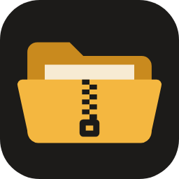
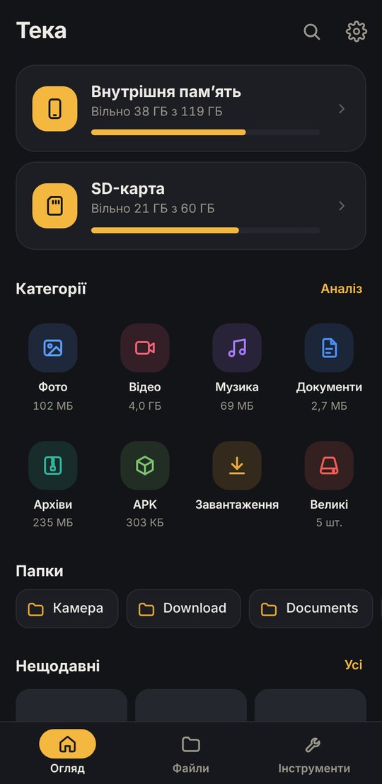
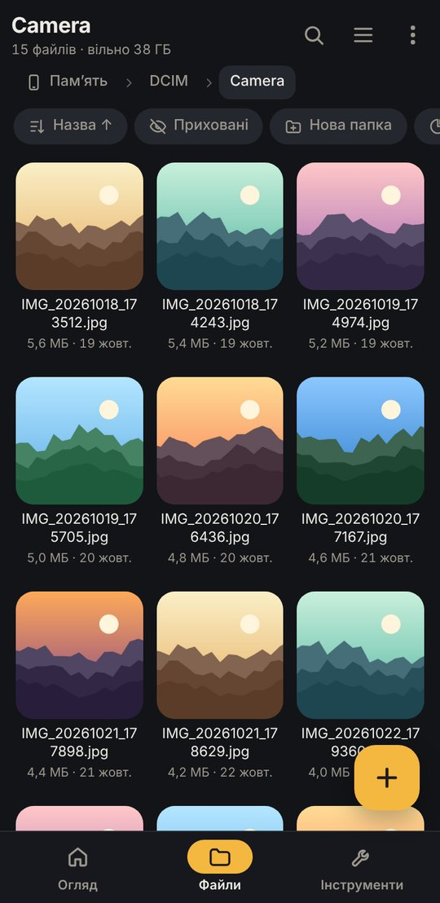
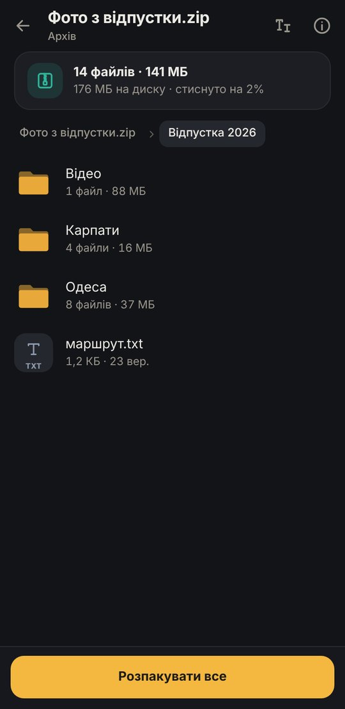
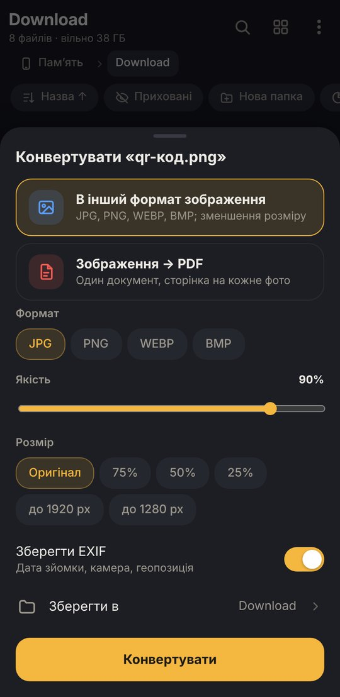
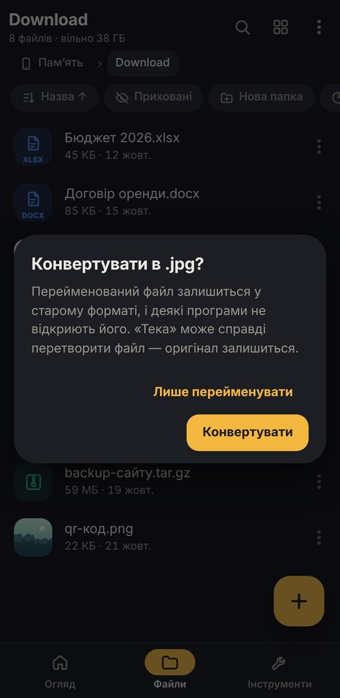
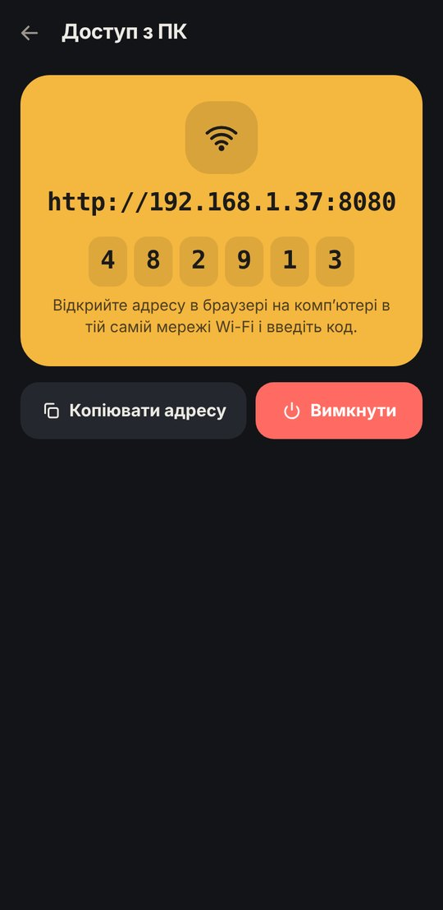
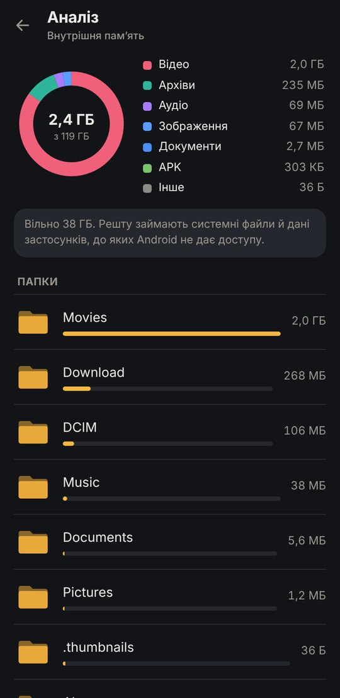
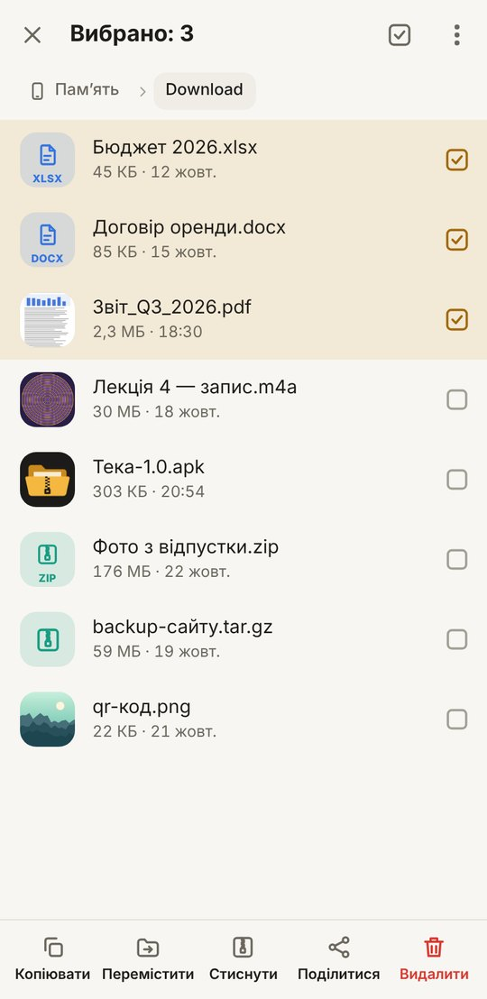
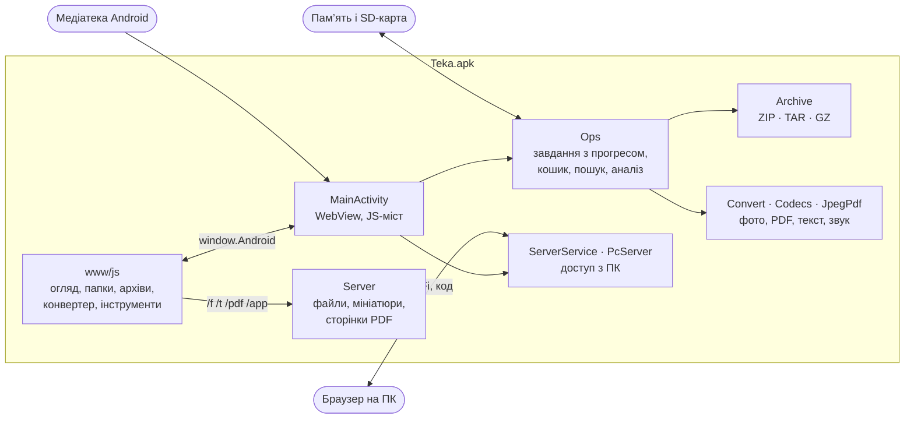

<div align="center">



# Тека

**Файловий менеджер для Android у дусі Cx Провідника — з вбудованим архіватором, зміною розширень<br>і конвертером: фото, PDF, текст, звук. Кошик, аналіз пам’яті, застосунки, доступ з ПК через браузер. Українською.**

[](#встановлення)
[](apk/)
[](apk/)
[](test/)
[](#)

[**⬇ Завантажити APK**](https://github.com/hatogg/Teka/raw/main/apk/Teka-1.0.apk) &nbsp;·&nbsp;
[Посібник](docs/guide.md) &nbsp;·&nbsp;
[Доступ з ПК](docs/guide.md#доступ-з-пк) &nbsp;·&nbsp;
[Модулі коду](docs/README.md)

</div>

<br>

<table>
  <tr>
    <td align="center"><br><sub>Огляд</sub></td>
    <td align="center"><br><sub>Папки й мініатюри</sub></td>
    <td align="center"><br><sub>Архів без розпакування</sub></td>
    <td align="center"><br><sub>Конвертер</sub></td>
  </tr>
  <tr>
    <td align="center"><br><sub>Зміна розширення</sub></td>
    <td align="center"><br><sub>Доступ з ПК</sub></td>
    <td align="center"><br><sub>Аналіз пам’яті</sub></td>
    <td align="center"><br><sub>Світла тема й вибір</sub></td>
  </tr>
</table>

## Можливості

| Розділ | Що вміє |
|---|---|
| **Провідник** | Внутрішня пам’ять і SD-карта, хлібні крихти, список або сітка (запам’ятовується для кожної папки), сортування за назвою, датою, розміром, типом, приховані файли, закладки, швидкі папки. Мініатюри фото, відео, обкладинок музики, значків APK і першої сторінки PDF |
| **Дії з файлами** | Вибір кількох (довгий дотик або дотик до значка), копіювання й переміщення через «Вставити» з вибором при збігу назв (зберегти обидва, замінити, пропустити), перейменування, групове перейменування з нумерацією, заміною й регістром, нова папка чи файл, поділитися, відкрити в іншому застосунку, властивості з MD5, SHA-1 і SHA-256 |
| **Архіватор** | Створює ZIP (без стиснення, швидко, звичайно, максимум), TAR.GZ і TAR. Відкриває й розпаковує ZIP, TAR, TAR.GZ, GZ, а також JAR, APK, APKS, XAPK, DOCX, XLSX, EPUB та інші ZIP-формати. Перегляд архіву без розпакування, відкриття окремого файлу з архіву, розпакування вибраного, у окрему папку чи сюди. Кириличні назви з архівів Windows (CP866) читаються правильно |
| **Зміна розширення** | Для одного файлу чи групи, з підказками. Якщо нове розширення означає інший формат (PNG → JPG, WAV → M4A, TXT → PDF), «Тека» попереджає й пропонує справжню конвертацію |
| **Конвертер** | Фото → JPG, PNG, WEBP, BMP зі зміною якості й розміру та збереженням EXIF; фото → один PDF (A4, Letter або за розміром фото, з полями); PDF → зображення (72/150/300 dpi, вибір сторінок); текст → PDF; зміна кодування тексту (UTF-8, Windows-1251, CP866, KOI8-U…) і кінців рядків; аудіо → M4A (AAC до 320 кбіт/с) або WAV; звук із відео; відео без звуку. Оригінали не змінюються |
| **Переглядачі** | Галерея з гортанням і масштабом щипком, відео, музичний програвач з чергою з папки, текст із вибором кодування і редагуванням, PDF посторінково, відомості про APK (версія, дозволи, чи встановлено) |
| **Кошик** | Видалене спершу потрапляє в кошик на тому ж сховищі й зберігається 7–90 днів (типово 30); відновлення на старе місце |
| **Аналіз пам’яті** | Кільцева діаграма за типами, найбільші папки з переходом углиб, найбільші файли з видаленням |
| **Застосунки** | Список встановлених і системних, пошук, сортування за розміром і датою. Збереження APK (застосунки з частинами — набором `.apks`), поділитися APK, видалити, відкрити налаштування. Встановлення APK і наборів APKS / XAPK / APKM |
| **Доступ з ПК** | Вмикаєте — і на комп’ютері в тій самій мережі Wi-Fi відкриваєте адресу в браузері. Вхід за шестизначним кодом; можна гортати папки, завантажувати файли (з перемотуванням відео), цілі папки одним ZIP, вивантажувати файли на телефон і створювати папки |
| **Пошук** | За назвою (з `*` і `?`), за типом, а також у тексті файлів; результати з’являються одразу під час пошуку |

## Встановлення

1. Завантажте [**Teka-1.0.apk**](https://github.com/hatogg/Teka/raw/main/apk/Teka-1.0.apk) (файл лежить у папці [`apk/`](apk/)).
2. Відкрийте файл на телефоні й дозвольте встановлення з цього джерела.
3. Запустіть «Теку» і натисніть **Надати доступ** → увімкніть **«Доступ до всіх файлів»**. Без нього Android не дає файловому менеджеру бачити пам’ять (на Android 7–10 — звичайний дозвіл на сховище).

### Навіщо дозволи

| Дозвіл | Для чого |
|---|---|
| Доступ до всіх файлів | Показувати, копіювати, стискати й конвертувати файли в пам’яті й на SD-карті |
| Встановлення й видалення застосунків | Встановлювати APK і набори APKS, видаляти застосунки зі списку |
| Список застосунків | Сторінка «Застосунки» і збереження APK |
| Мережа, Wi-Fi, сповіщення, служба переднього плану | Лише «Доступ з ПК»: сервер у локальній мережі працює, поки ви його не вимкнете, а сповіщення показує адресу і код |

## Звичне з Cx Провідника

| У Cx | У «Теці» |
|---|---|
| Локальне, Бібліотека | **Огляд** (сховища, категорії, швидкі папки, нещодавні) і **Файли** |
| Стиснути / розпакувати | Те саме плюс перегляд архіву без розпакування, TAR.GZ, правильні кириличні назви з Windows |
| Доступ з мережі | **Доступ з ПК** — у звичайному браузері, без FTP-клієнта, з кодом входу |
| Менеджер застосунків | **Застосунки**: копії APK, набори `.apks`, встановлення XAPK |
| Аналіз сховища, кошик | Є, обидва |
| — | **Конвертер** і **зміна розширення** з підказкою конвертувати |

## Як це влаштовано



Інтерфейс — сторінка у WebView на віртуальному домені `appassets.androidplatform.net`. Нативна частина на Java працює з файлами напряму, виконує довгі операції у фонових потоках і повідомляє сторінці прогрес, роздає файли (з Range для перемотування відео) та мініатюри. Архіватор, PDF із фото, BMP, WAV і HTTP-сервер для ПК написані на чистій Java без Android і перевірені тестами на звичайній JVM.

## Модулі

| Модуль | Файли | Що робить |
|---|---|---|
| [Android-частина](docs/modules/android.md) | `MainActivity`, `Server`, `FilesProvider`, `Thumbs` | WebView, JS-міст (33 методи), дозволи, відкриття файлів іншими застосунками, мініатюри, сторінки PDF |
| [Файли й завдання](docs/modules/files.md) | `Fs`, `Ops`, `Names`, `Store`, `Encodings` | Сховища, категорії з медіатеки, копіювання й переміщення, кошик, пошук, аналіз, групове перейменування |
| [Архіватор](docs/modules/archive.md) | `Archive` | ZIP, TAR, TAR.GZ, GZ: перегляд, створення, розпакування, захист від виходу за межі папки |
| [Конвертер](docs/modules/convert.md) | `Convert`, `Codecs`, `JpegPdf` | Зображення, PDF, текст, звук і відео через засоби Android |
| [Доступ з ПК і застосунки](docs/modules/pc.md) | `PcServer`, `ServerService`, `Apps` | HTTP-сервер з кодом входу, служба переднього плану, APK |
| [Інтерфейс](docs/modules/ui.md) | `www/js/*.js`, `app.css` | Огляд, папки, вибір, буфер, архіви, конвертер, переглядачі, інструменти |
| [Збирання і тести](docs/modules/build.md) | `build.sh`, `test/`, `mock.js` | APK без Gradle, 193 тести на JVM, інтерфейс у браузері |

## Структура репозиторію

```
Teka/
├── apk/Teka-1.0.apk            готовий підписаний APK
├── build.sh                    збирання APK однією командою
├── test/
│   ├── run.sh                  тести: кодування, архіви, сервер, конвертер
│   ├── ui.sh                   інтерфейс у браузері з імітацією телефона
│   ├── mockdata.py             демо-картинки, звук і відео для ui.sh
│   └── *Test.java
├── app/
│   ├── AndroidManifest.xml     дозволи, служба доступу з ПК, постачальник файлів
│   ├── java/ua/teka/files/     нативна частина (16 класів)
│   ├── assets/www/             інтерфейс: index.html, css/, js/ (14 модулів)
│   ├── res/                    іконка, тема
│   └── tools/                  підпис і вирівнювання APK
└── docs/                       посібник, модулі, скриншоти
```

## Збирання з коду

```bash
git clone https://github.com/hatogg/Teka.git
cd Teka
./test/run.sh     # 193 тести на JVM
./build.sh        # → build/Teka-1.0.apk
./test/ui.sh      # інтерфейс у браузері: http://localhost:8765/www/index.html
```

Потрібні JDK 17+, Python 3, `zip`, `unzip`, `curl` і `git`; `aapt2`, D8 і `android.jar` завантажуються автоматично. Для тестів конвертера ще потрібні `pdfinfo`, `qpdf`, `pdftoppm` (poppler) і `ffprobe`. Подробиці — у [docs/modules/build.md](docs/modules/build.md).

## Приватність

«Тека» нічого не надсилає в інтернет і не має реклами чи аналітики. Мережа використовується лише для «Доступу з ПК»: сервер слухає локальну мережу, тільки поки ви його не вимкнете, і без шестизначного коду нічого не показує. Налаштування лежать у внутрішній пам’яті застосунку.

## Обмеження

- RAR і 7z не відкриваються; ZIP-архіви з паролем — теж (є попередження).
- MP3 не створюється: в Android немає кодувальника MP3, тому звук зберігається в M4A (AAC) або WAV.
- Перегляд HEIC, DNG і TIFF іде через зменшену копію; конвертувати HEIC можна на Android 9+.
- Доступ з ПК працює в межах однієї мережі Wi-Fi або точки доступу телефона, без шифрування (HTTP) — вмикайте його вдома, а не в публічних мережах.
- Скриншоти зняті в Chrome з імітацією Android-моста й демо-файлами; на телефоні вигляд той самий, але системний рядок стану свій.

<div align="center">
<sub>Тека · Android 7.0+ · без реклами, без акаунтів, українською</sub>
</div>
